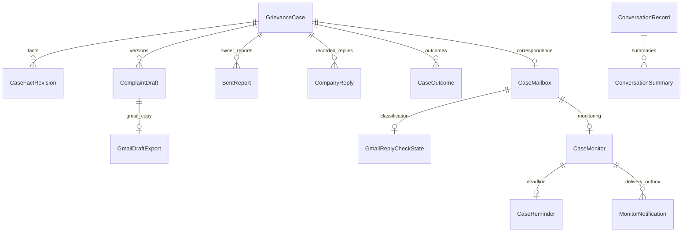

# Current data model and final-review decisions

Snapshot: 24 November 2026. These are implemented models, not a proposed multi-user design. The schema was developed incrementally with feature tickets; its ownership and cardinality choices still need the user's consolidated review.

## Storage and ownership

| Data | Current implementation | Review limitation |
| --- | --- | --- |
| Owner identity | String owner IDs, scoped in services and queries; one configured Telegram owner | No Django User/account foreign-key model; not a hosted multi-user application |
| Conversation | ConversationRecord JSON history/archive; versioned ConversationSummary snapshots | Not a normalized message table; assess size and retention before broader rollout |
| Preferences | Separate preferences app, explicit changes and forgetting | Preferences are not case facts or automatic inferences |
| Cases | GrievanceCase, fact revisions, messages, research briefs/results, selected case | CaseSelection is per owner/conversation; facts and drafts remain case scoped |
| Drafts | Immutable ComplaintDraft versions; GmailDraftExport maps local version to provider draft | Local draft creation is not proof of sending |
| Email | CaseMailbox stores selected thread, imported excerpts and candidates; GmailReplyCheckState stores checked evidence | Currently one selected mailbox/thread per case; multiple threads require a reviewed migration |
| Monitoring | CaseMonitor stores active state, generation, schedule and seen-message state | Local polling, not Google push/webhooks; explicit stop survives future case help |
| Reminders | One CaseReminder per monitor; deadline, revision, sending provenance, evidence IDs, status | One active one-time deadline per case; rescheduling invalidates pending delivery |
| Notifications | MonitorNotification outbox with generation/revision and delivery-attempt state | Ambiguous external delivery is not blindly retried; not an exactly-once guarantee |
| Operation/trace records | Receipts, owner epochs, turn registrations, trace links | Protect against duplicate mutation and support deletion; separate from business facts |
| Google credentials | macOS Keychain; filesystem stores a nonsecret active-slot pointer | Not stored in PostgreSQL; hosted-user design described in OAuth research |

PostgreSQL contains readable application content; there is no application-level field encryption. Local Langfuse is a separate copy of captured content with separate cleanup. Database persistence is not a backup policy.

## Reminder decisions

An active case-help workflow starts monitoring once relevant correspondence has been selected, and confirms this in the reply. An explicit stop is persisted on the case even before correspondence or a monitor exists; case help never silently re-enables it. A new explicit reminder request can enable monitoring.

A no-response reminder needs an exact future deadline and either Gmail sent-message evidence or an explicitly recorded sent report. Owner-reported sending remains labeled as such. The worker refreshes evidence before queued reminder delivery, including after restart, cancels only the reminder for a substantive reply, asks about uncertain evidence, and preserves state on failures. A draft alone never counts as sent. Stop, disconnect, close and deletion invalidate pending notifications. Reconnection does not restart monitoring automatically.

## Infrastructure naming

`grievance_postgres-data` is the existing Docker Compose project/volume name. It is not a table name. Keep it attached until a tested migration: export the database, restore into a consistently named `personal-agent` stack/volume, verify migrations and record counts, switch configuration, and retain rollback storage. Simply renaming the Compose project would create an empty volume and make existing data appear lost.

The final review should approve ownership/cardinality, retention and encryption requirements, the future User/GmailConnection model, and infrastructure names. Then run the fresh-user demo against an isolated database and credential namespace; do not erase the current mailbox connection or cases.
